<div align="center">

# floki24-commerce

**A fast, four-language headless storefront for [floki24.ch](https://floki24.ch), the Swiss
shop for saunas, garden furniture, wellness and more.**

Built with Next.js 16 · React 19 · TypeScript · Shopify Storefront API

[Quick start](#-quick-start) · [Tour](#-a-quick-tour) · [Using the website](#-working-with-the-website) ·
[Architecture](#-how-it-works) · [Development](#-development)

<br>

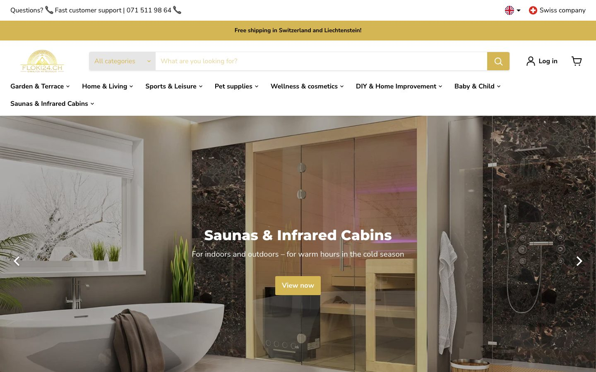

</div>

---

## ✨ Highlights

|     |                                                                                                                                                         |
| --- | ------------------------------------------------------------------------------------------------------------------------------------------------------- |
| 🛋️  | **Looks like the real shop.** The colours, fonts, mega menu, slideshow, footer and every homepage section follow floki24.ch's Shopify theme.            |
| 🌍  | **Four languages.** Deutsch, English, Français and Italiano, switched with a flag menu. Dates, prices and the interface follow the chosen language.     |
| 🔎  | **Search that forgives.** Live suggestions while you type. Matches brands and categories, and tolerates typos (_"Heavenly nest"_ finds _Havenly Nest_). |
| 🎛️  | **Filters and sorting.** Filter by product type, brand and availability, sort by price, name or relevance, and switch between grid and list view.       |
| 🛒  | **Full purchase flow.** Quick buy from the listing, cart with live quantities, a Shopify-style checkout and an order confirmation.                      |
| 👤  | **Customer accounts.** Register, log in and see your past orders.                                                                                       |
| 📱  | **Built for every screen.** A compact sticky header on scroll, a drill-down menu on phones and keyboard-accessible menus and dialogs.                   |
| ⚡  | **Fast by default.** Partial prerendering, cached Shopify data and images served straight from the Shopify CDN.                                         |

> **No Shopify account needed to try it.** Without credentials the app runs on the public
> [mock.shop](https://mock.shop) demo catalogue (about 1,000 home-goods products in USD), and it
> stores accounts and orders locally. Connect a real store and the same code serves live data.

---

## 🚀 Quick start

You need **Node.js 22 or newer**.

```bash
git clone <this-repo> floki24-commerce
cd floki24-commerce
npm install
npm run dev
```

Open **http://localhost:3000**. That's it: the demo catalogue loads automatically.

For a production build (faster, and what the end-to-end tests use):

```bash
npm run build
npm start          # http://localhost:3000
```

### Connecting a real Shopify store

1. In the Shopify admin, open **Settings → Apps and sales channels → Headless** and create a
   storefront.
2. Copy `.env.example` to `.env.local` and fill in:

   | Variable                          | What it is                                                             |
   | --------------------------------- | ---------------------------------------------------------------------- |
   | `SHOPIFY_STORE_DOMAIN`            | e.g. `floki24.myshopify.com`                                           |
   | `SHOPIFY_STOREFRONT_ACCESS_TOKEN` | The **public** Storefront API token                                    |
   | `NEXT_PUBLIC_SITE_URL`            | Public origin, used for canonical URLs, `sitemap.xml` and `robots.txt` |
   | `SHOPIFY_REVALIDATION_SECRET`     | Optional. Webhook secret for instant cache updates (see below)         |

3. Restart the server. Products, collections, search, cart and customer accounts now come from
   Shopify, and checkout hands over to Shopify's hosted checkout.
4. Optional: point Shopify webhooks for `products/*`, `collections/*` and
   `inventory_levels/update` at `/api/revalidate` so changes show up immediately.

---

## 🖼️ A quick tour

<table>
  <tr>
    <td width="50%">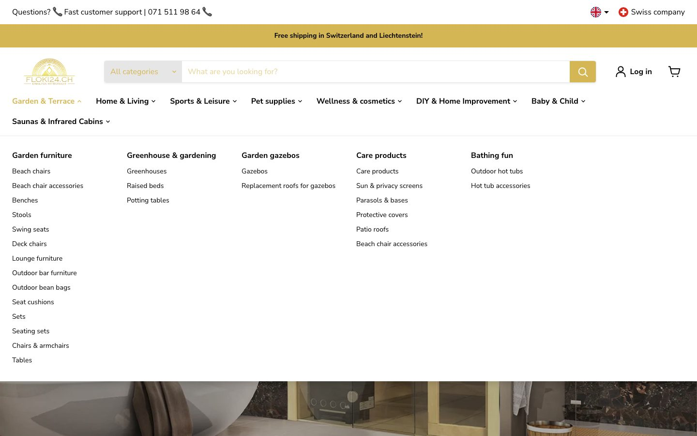<br><sub><b>Mega menu</b>: opens on click and lists every category of the real shop.</sub></td>
    <td width="50%">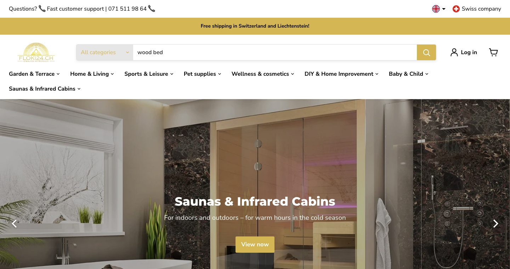<br><sub><b>Live search</b>: suggestions with images and prices while you type.</sub></td>
  </tr>
  <tr>
    <td>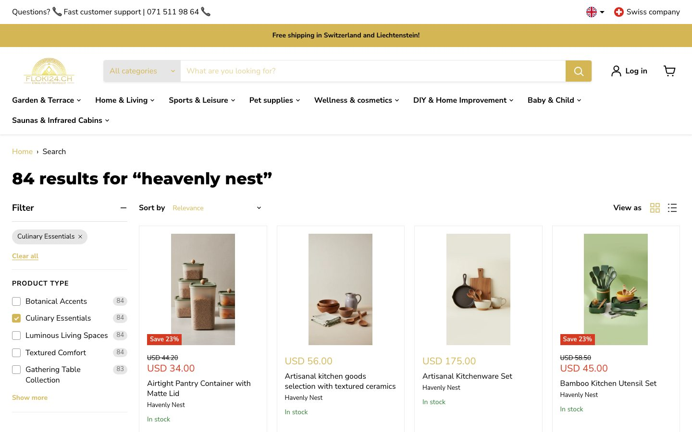<br><sub><b>Filters</b>: active filters appear as chips you can remove with one click.</sub></td>
    <td>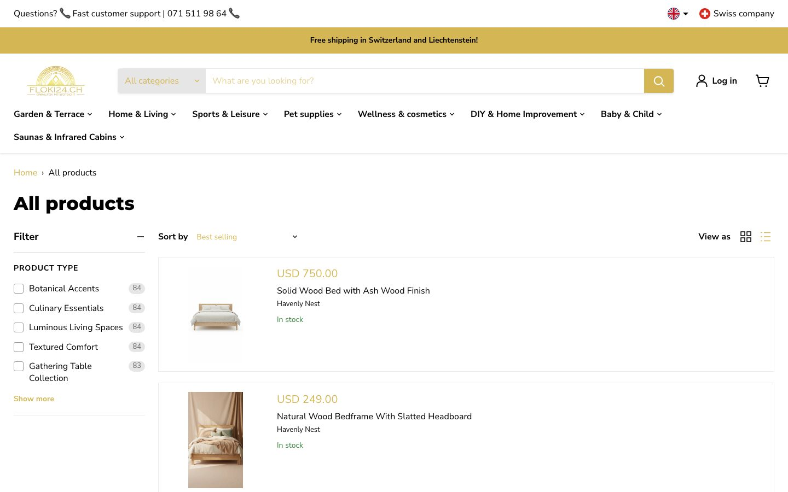<br><sub><b>Grid or list</b>: "View as" remembers your choice.</sub></td>
  </tr>
  <tr>
    <td>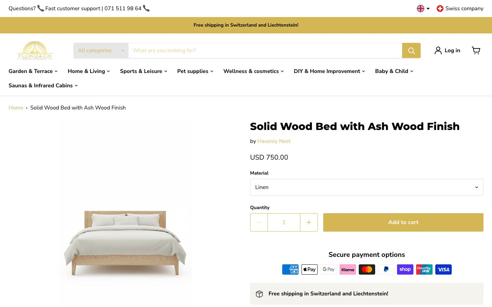<br><sub><b>Product page</b>: gallery, variants, quantity and payment options.</sub></td>
    <td>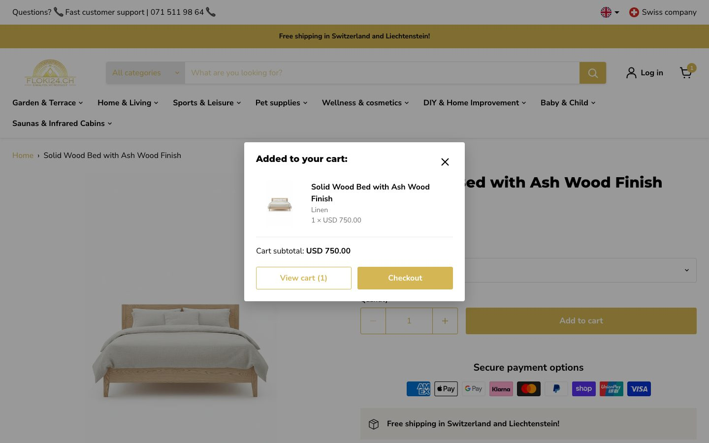<br><sub><b>Added to cart</b>: go to the cart or straight to checkout.</sub></td>
  </tr>
  <tr>
    <td>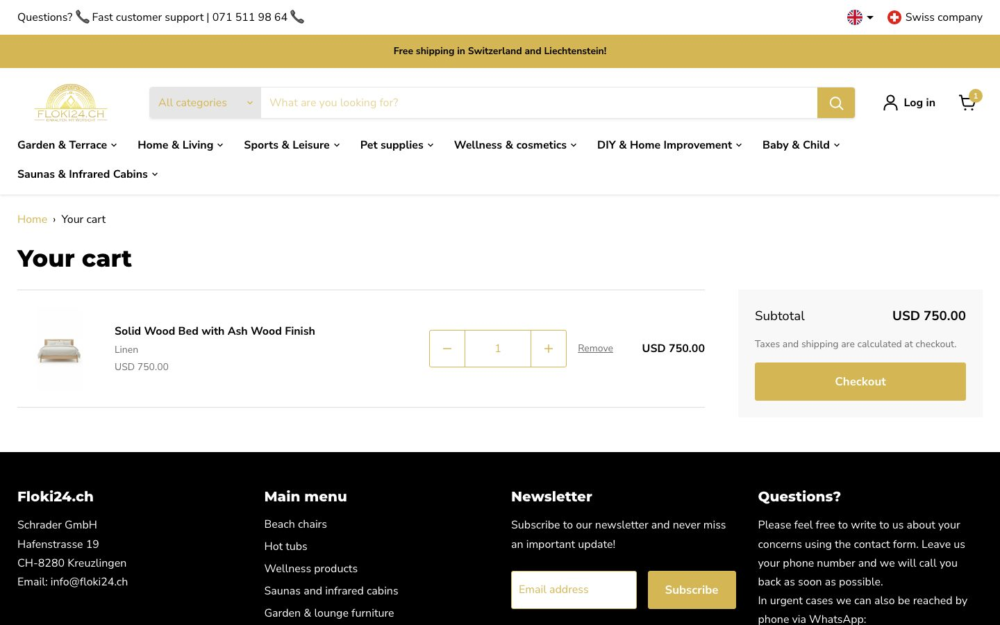<br><sub><b>Cart</b>: quantities update instantly and survive a reload.</sub></td>
    <td>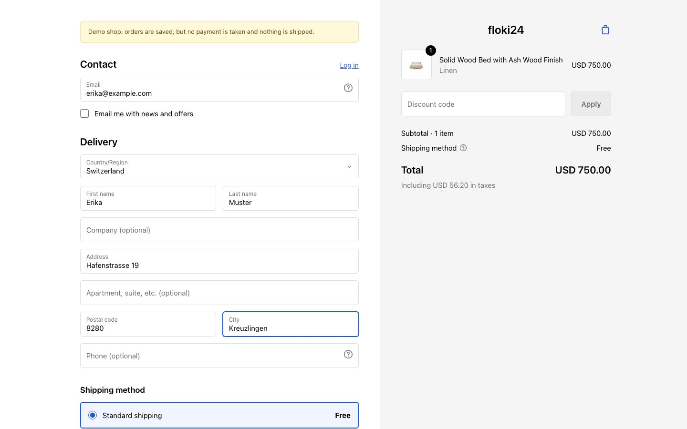<br><sub><b>Checkout</b>: modelled on Shopify's own checkout.</sub></td>
  </tr>
  <tr>
    <td>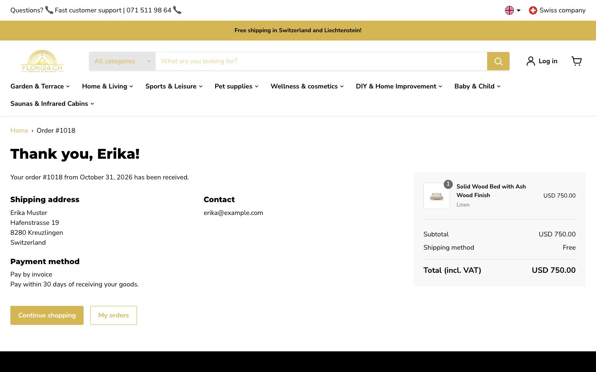<br><sub><b>Order confirmation</b>: address, payment method and order summary.</sub></td>
    <td>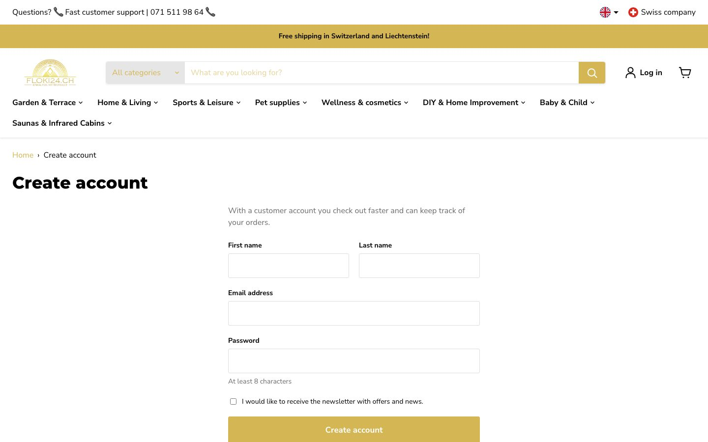<br><sub><b>Accounts</b>: register, log in and review your orders.</sub></td>
  </tr>
  <tr>
    <td>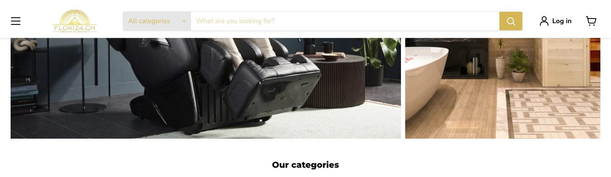<br><sub><b>Sticky header</b>: shrinks on scroll and keeps search and the menu (☰) at hand.</sub></td>
    <td>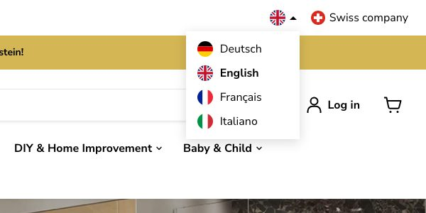<br><sub><b>Languages</b>: switch between DE, EN, FR and IT at any time.</sub></td>
  </tr>
</table>

<p align="center">
  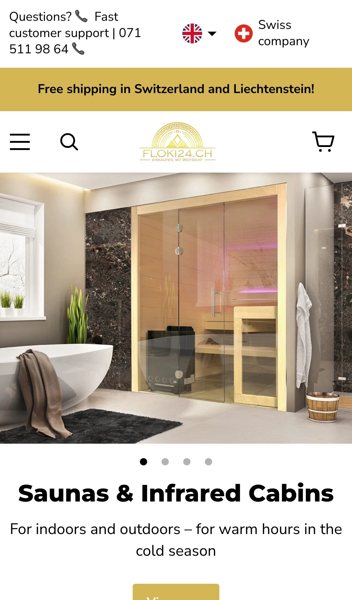
  &nbsp;&nbsp;&nbsp;
  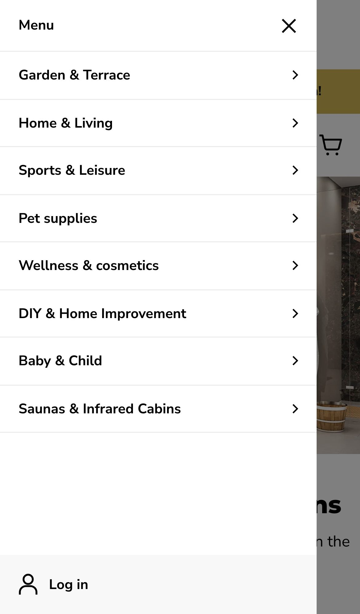
  <br><sub><b>On a phone</b>: the same shop, with a drill-down menu.</sub>
</p>

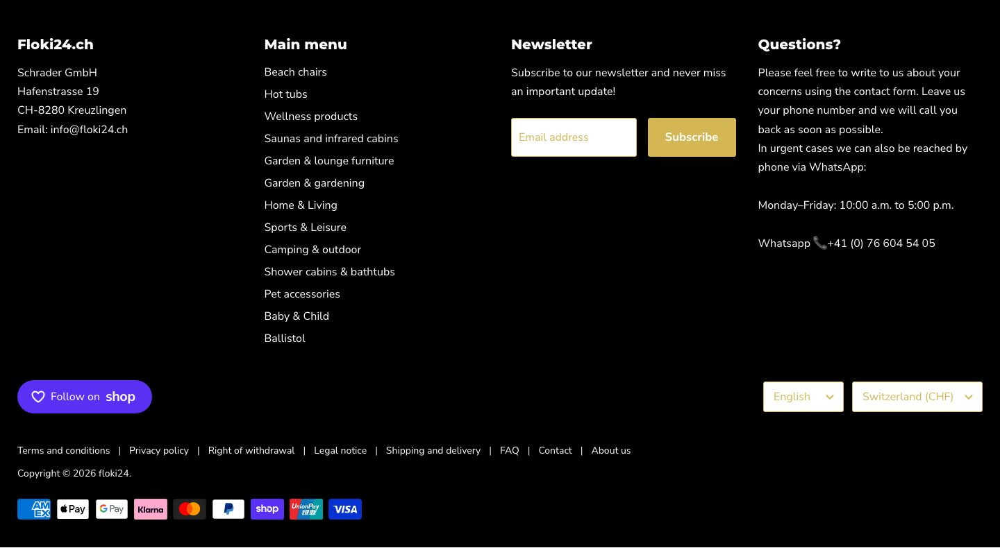

---

## 🧭 Working with the website

A step-by-step guide for shoppers and for anyone testing the shop.

### 1. Choose your language

- Click the **flag** at the top right and pick **Deutsch, English, Français or Italiano**. You can
  also use the **language selector in the footer**.
- The choice is remembered, so the next visit opens in the same language.
- To share a link in a specific language, put the language in front of the path, for example
  `http://localhost:3000/en/collections/all`. The visitor is switched to English and sent to the
  normal URL.

### 2. Browse the categories

- Click a category in the main menu (for example **Garden & Terrace**) to open the **mega menu**,
  then pick a sub-category. Click the category again, press <kbd>Esc</kbd> or click elsewhere to
  close it.
- Once you scroll down, the header shrinks. Use the **☰** button on its left to open the menu
  from anywhere on the page.
- On a phone, tap **☰** and drill down through the categories with the **›** arrows.
- The homepage slideshow can be moved with the **‹ ›** arrows or the dots below it.

### 3. Search

- Type in the search bar. After a couple of letters, **suggestions** appear with pictures and
  prices. Click one to open the product, or press <kbd>Enter</kbd> to see all results.
- Narrow the search to one department with the **"All categories"** dropdown on the left of the
  search bar.
- Search understands brand names, product types and small typos, and every word must match:
  `wood bed` finds wooden beds, not every bed and every wooden item.

### 4. Filter, sort and change the view

On a category or search results page:

1. Tick options in the **Filter** sidebar (product type, brand, availability). The number next to
   each option shows how many products it has.
2. Your active filters appear as **chips** at the top of the sidebar. Click **×** on a chip to
   remove it, or **Clear all** to start over.
3. Change the order with **Sort by** (relevance, best selling, price, name, date).
4. Switch between **grid** and **list** with the **View as** buttons. Your choice is remembered.
5. Use the page numbers at the bottom to see more products.

The filters and sort order are part of the URL, so you can bookmark or share a filtered list.

### 5. Look at a product

- Click a product to open its page. Choose a **variant** (colour, material, size), and the price
  and picture update.
- Set the **quantity** with **−** and **+**.
- On a desktop, product cards also have a **Quick buy** button: pick a variant and add to the
  cart without leaving the list.

### 6. Add to cart and check out

1. Click **Add to cart**. A dialog confirms it and offers **View cart** or **Checkout**.
2. In the **cart** (the basket icon at the top right), change quantities or **Remove** items. The
   subtotal updates immediately.
3. Click **Checkout** and fill in your **email** and **delivery address**. Shipping within
   Switzerland and Liechtenstein is free.
4. Choose a payment method and click **Buy now**.
5. You see the **order confirmation** with your order number, and the cart is emptied.

> In demo mode no payment is taken and nothing is shipped. **Pay by invoice** and **bank
> transfer** complete the order; card, PayPal, Klarna and TWINT need a real payment provider, so
> the demo asks you to pick one of the first two.

### 7. Create an account and see your orders

1. Click **Log in** at the top right, then **Create account**.
2. Enter your name, email and a password of at least 8 characters.
3. You're logged in and taken to **My account**, which lists your orders. Orders placed while
   logged in show up there, and checkout fills in your email for you.
4. **Log out** from the account page.

### 8. Get in touch

- The phone number in the top bar is a `tel:` link. Click it on a phone to call.
- The footer has the company address, the WhatsApp number, the newsletter sign-up and links to
  the legal pages (terms, privacy, withdrawal, shipping, FAQ and more).

---

## 🏗️ How it works

```
src/
├── proxy.ts               Picks the language from a cookie and rewrites /path → /{lang}/path
├── app/[lang]/
│   ├── (shop)/            Home, collections, products, search, cart, account, blogs, pages, policies
│   ├── (checkout)/        The checkout, without the shop header and footer
│   └── [...missing]/      Branded 404 page
├── app/api/               Predictive search, product JSON for quick buy, webhook revalidation
├── components/
│   ├── layout/            Top bar, sticky header, mega menu, mobile drawer, search, footer
│   ├── home/              Slideshow, highlights, tiles, sliders, …
│   ├── listing/           Filter sidebar, sorting, grid/list toggle, pagination
│   ├── product/           Product card, quick buy, gallery, variant picker, add to cart
│   ├── cart/ checkout/    Cart context and actions, checkout form and order summary
│   ├── account/           Login and registration forms
│   └── i18n/              Language switcher and flags
├── content/               Menu, homepage sections, footer and their translations (typed, no CMS)
├── i18n/                  Locale config and the de / en / fr / it dictionaries
└── lib/
    └── shopify/           Storefront API client, queries, types and the demo-mode layer
```

**Rendering.** Cache Components and Partial Prerendering are on. Page shells (header, menu,
footer, homepage content) are prerendered. Request-specific parts (cart, search results, the
current product) stream in behind `Suspense` with skeletons. Shopify data is cached with
`"use cache"`, `cacheLife` and cache tags, and webhooks can invalidate the tags.

**Languages.** The URL stays the same in every language. `proxy.ts` reads the `locale` cookie and
rewrites the request to `/{lang}/…` internally, and `next/root-params` makes the language part of
every cache key. Server components use `getDictionary()`, client components `useDictionary()`.
Menu and homepage text is translated in `src/content/translations.ts`.

**Data.** Server components read from `lib/shopify/*`. Each module owns its GraphQL query, maps
the response to the domain types in `types.ts` and caches the result. Components never see
GraphQL shapes.

**Demo mode.** mock.shop's own search ignores brands and returns loosely related products, and it
has no filters, customer accounts or working checkout. So when no credentials are set:

| Feature                          | Handled by                                                                                                                                 |
| -------------------------------- | ------------------------------------------------------------------------------------------------------------------------------------------ |
| Search, filters, sorting, paging | `mock-catalog.ts`: loads the whole catalogue once (cached) and ranks it with `text-search.ts` (field weights, prefixes and typo tolerance) |
| Customer accounts                | `mock-customers.ts`: scrypt-hashed passwords and expiring tokens in `.data/`                                                               |
| Checkout and orders              | `mock-orders.ts` plus the in-app checkout                                                                                                  |
| floki24 collection handles       | `mock-shop.ts` maps them to demo collections                                                                                               |

With credentials, all of these go to Shopify itself.

**Cart.** The cart id lives in an `httpOnly` cookie. Changes are Server Actions that validate
their input, and quantities update optimistically with `useOptimistic`, like the filter checkboxes.

**Images.** A custom `next/image` loader asks the Shopify CDN for the right size directly, so the
Next.js image optimizer isn't needed.

**Accessibility and SEO.** Native `<dialog>` elements, keyboard-operable menus, carousel and
filters, labelled landmarks, `aria-busy` while lists reload. Per-page metadata, product JSON-LD,
a paginated `sitemap.xml` and `robots.txt`.

---

## 🛠️ Development

| Command             | What it does                                                       |
| ------------------- | ------------------------------------------------------------------ |
| `npm run dev`       | Development server with hot reload                                 |
| `npm run build`     | Production build                                                   |
| `npm start`         | Serve the production build                                         |
| `npm run lint`      | ESLint                                                             |
| `npm run typecheck` | Generate route types, then `tsc --noEmit`                          |
| `npm run format`    | Format everything with Prettier                                    |
| `npm test`          | Unit tests (Vitest)                                                |
| `npm run test:e2e`  | End-to-end tests (Playwright, desktop and mobile, on a prod build) |

**Tests.**

- **Unit tests** (`src/**/*.test.ts`) cover the parts that are easy to get subtly wrong: price
  and date formatting, variant resolution, URL ↔ listing parameters, GraphQL fragments, response
  reshaping and search scoring.
- **End-to-end tests** (`e2e/`) walk through the main journeys: homepage, collection → sort →
  product, cart changes that survive a reload, quick buy, search, 404, and a full checkout to the
  order confirmation. Run `npm run build` first; the tests start their own server on port 3100.
- **CI** (`.github/workflows/ci.yml`) runs formatting, lint, type check and unit tests, then the
  build and the end-to-end suite.

**Adding a translation.** Add the key to all four files in `src/i18n/dictionaries/`. TypeScript
fails the build if one language is missing it. Use `{placeholders}` and `format()` for values.

**Updating the screenshots.** With the production server running:

```bash
node scripts/screenshots.mjs    # writes docs/screenshots/*.jpg
```

**Local data.** Demo accounts and orders are saved in `.data/` (ignored by git). Delete the folder
to start fresh.

---

## 📌 Good to know

- **Demo data is the demo's data.** On mock.shop, products are English home goods priced in USD.
  With a real store you get floki24's own products in CHF.
- **Third-party widgets** on the original (Trusted Shops, the rewards launcher, the FAQ bubble)
  aren't included. They're external scripts tied to the shop's own accounts.
- **Brand colour contrast.** The gold accent (`#d4b654`) is kept for fidelity, but it doesn't
  meet WCAG AA contrast for small text on white. A production fix would darken it for text only.
- **404 status on streamed pages.** Product, collection and article pages stream, so a missing
  page is sent with status 200 plus `noindex`. Search engines still treat it as missing.

<div align="center">
<br>
Made for <a href="https://floki24.ch">floki24.ch</a> 🇨🇭
</div>
